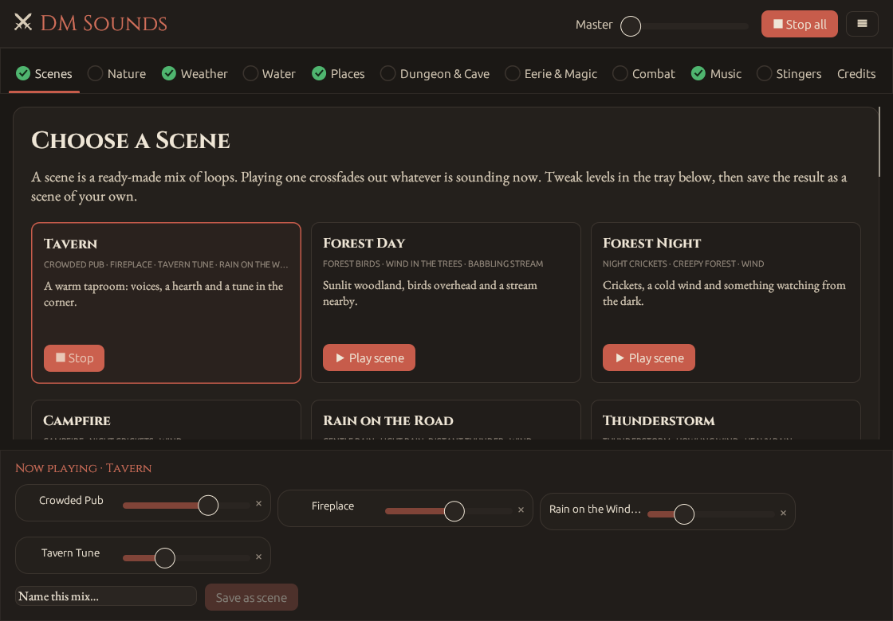

# DM Sounds

An ambient soundboard for Dungeon Masters: 101 free, openly licensed loops and
stingers, mixed live from a single Windows executable. Styled after Character
Forge.



## What it does

- **Scenes.** Twenty-four ready-made mixes (Tavern, Forest Night, Dungeon,
  Thunderstorm, Sea Voyage, Battle, Haunted Manor, …). Playing one crossfades
  out whatever was sounding.
- **Layers.** Every loop has its own play toggle and level slider. Stack as
  many as you like across the Nature, Weather, Water, Places, Dungeon & Cave,
  Eerie & Magic, Combat and Music tabs.
- **Stingers.** One-shot effects (sword clashes, thunder, bells, doors, roars,
  spells) that fire once on top of the mix.
- **Tray.** The bar at the bottom shows what is playing with a mini slider and
  a remove button per sound. Type a name and press *Save as scene* to keep the
  mix; your scenes appear under the built-in ones.
- **Fades.** Starts and stops are 1.5 s fades, never a hard cut. `Esc` or
  *Stop all* fades everything out.
- **Memory.** Master volume, your scenes and the last mix are saved to
  `%APPDATA%\dm-sounds\state.json`. Tick *Resume last mix on launch* in the
  ☰ menu to pick up where you left off.

## Download

Every push builds a Windows x64 executable in GitHub Actions. Open the latest
run under **Actions → Build**, download the `DM-Sounds-windows-x64` artifact,
unzip and run `DM-Sounds.exe`. Nothing to install; the sounds and fonts are
embedded in the file (about 60 MB).

Tagging a commit `v1.0.0` publishes a GitHub Release with the zip attached.

## Building it yourself

```
cargo build --release
```

Requires a recent stable Rust. On Linux you also need `libasound2-dev`. The
binary lands in `target/release/dm-sounds` (`.exe` on Windows).

## How it is put together

- **Rust + egui/eframe** for the interface. Immediate-mode UI keeps the whole
  app to a few hundred lines and starts instantly.
- **rodio** for playback. Each loop gets its own sink so levels and fades are
  independent; sliders are squared before they hit the sink so they feel
  linear to the ear.
- **Embedded bank.** `build.rs` reads `assets/sounds/manifest.json` and
  generates `include_bytes!` entries, so the executable is self-contained and
  nothing has to be found on disk at run time.
- **Prepared audio.** Every source was trimmed, normalised to -20 LUFS, cut to
  at most 75 s and crossfaded so the end flows into the start, then encoded as
  44.1 kHz stereo Ogg Vorbis at quality 4 (roughly 128 kbit/s). Rhythmic
  loops that were already seamless get only a 30 ms micro-crossfade at the
  wrap point.

## Adding sounds

1. Drop an `.ogg` into `assets/sounds/`.
2. Add an entry to `assets/sounds/manifest.json` with `id`, `name`,
   `category`, `kind` (`loop` or `oneshot`), `file`, `author`, `license`,
   `source` and a one-line `desc`.
3. Rebuild. The build script validates that the file and category exist.

Built-in scenes live in `assets/scenes.json` and reference sounds by `id`.

## Licences

Code is MIT. Every sound is CC0, public domain or CC BY, and every font is
under the SIL Open Font License; see [CREDITS.md](CREDITS.md) for the full
list with authors and source links.
